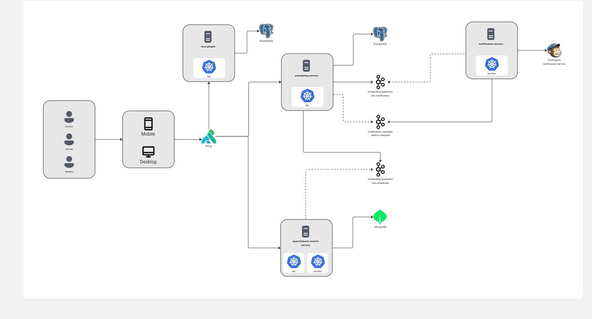
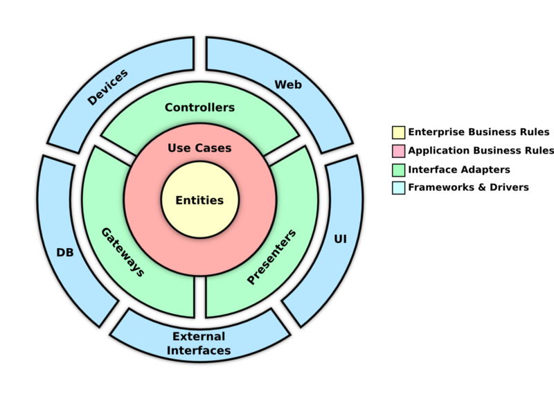
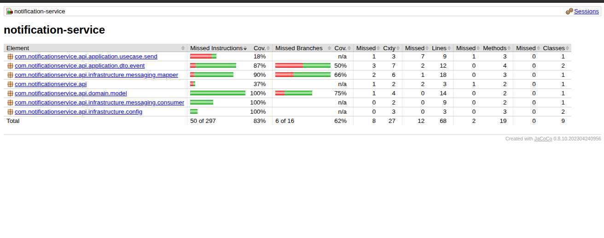

# notification-service

Microsserviço responsável por consumir eventos Kafka do topico `scheduling.appointment.notification` e processar notificacoes de consultas.

## Visao geral

O projeto segue um modelo de processamento assincrono com foco em isolamento operacional:

- **Worker (`worker`)**: consome eventos do Kafka e executa o caso de uso de notificacao.
- **Kafka como fronteira**: o produtor publica o evento e o `notification-service` faz o processamento de forma eventual.

Essa separacao permite escalar o consumo de mensagens independentemente do servico que publica os eventos.

## Stack

- Java 21
- Spring Boot 4.1.1
- Spring Kafka
- Jackson
- Lombok
- Docker e Docker Compose

## Arquitetura

### Instancia Worker

- roda com `spring.main.web-application-type=none`
- ativa Kafka no perfil `worker`
- consome exclusivamente o topico `scheduling.appointment.notification`
- usa retry automatico com `@RetryableTopic`
- direciona falhas persistentes para DLQ

### Camadas principais

- `application`: caso de uso de envio de notificacao
- `domain`: modelo interno da notificacao
- `infrastructure`: consumer Kafka, mapper de evento e configuracoes

## Kafka

| Topico | Consumer/Producer                                             | Consumer group |
| --- |---------------------------------------------------------------| --- |
| `scheduling.appointment.notification` | Consumer                                                      | `notification-service` |
| `scheduling.appointment.notification-retry` | Producer/Consumer| `notification-service` |
| `scheduling.appointment.notification-dlq` | Producer    | `notification-service` |

## Diagramas

### Arquitetura da solucao



### Arquitetura limpa



## Cobertura de testes



## Contrato do evento

### Payload

```json
{
  "appointmentId": "8bc1e803-32a0-4e84-844b-9e061f93db47",
  "patientId": "3fa85f64-5717-4562-b3fc-2c963f66afa6",
  "doctorId": "3fa85f64-5717-4562-b3fc-2c963f66afa6",
  "fullname": "marcelo",
  "email": "patient@example.com",
  "body": "Um novo agendamento foi feito para 18/09/2026 às 21:22.",
  "appointmentDateTime": "2026-09-18 21:22:25.894 +0000"
}
```

### Headers obrigatorios

- `X-Idempotency-Key`
- `X-Source-Service`

## Retry e DLQ

- Topic principal: `scheduling.appointment.notification`
- Topic de retry: `scheduling.appointment.notification-retry`
- Topic de DLQ: `scheduling.appointment.notification-dlq`
- Tentativas padrao: `4`

### Propriedades configuraveis

- `APP_KAFKA_TOPIC_APPOINTMENT_NOTIFICATION`
- `APP_KAFKA_RETRY_ATTEMPTS`
- `APP_KAFKA_RETRY_TOPIC_SUFFIX`
- `APP_KAFKA_DLQ_TOPIC_SUFFIX`
- `SPRING_KAFKA_BOOTSTRAP_SERVERS`
- `SPRING_KAFKA_CONSUMER_GROUP_ID`

## Execucao local

### Subir a infraestrutura

```bash
docker compose up -d
```

O compose sobe Kafka, Zookeeper, Kafka UI, cria os topicos do worker e inicia o container da aplicacao.

### Executar a aplicacao

```bash
./mvnw spring-boot:run
```

Ou, de forma explicita:

```bash
./mvnw spring-boot:run -Dspring-boot.run.profiles=worker
```

## Testes e build

```bash
./mvnw test
./mvnw clean test
./mvnw clean package -DskipTests
```

## Cobertura de testes


## Estrutura resumida

- `src/main/java/com/notificationservice/api/application/` - casos de uso e DTOs de entrada
- `src/main/java/com/notificationservice/api/domain/` - modelo de dominio da notificacao
- `src/main/java/com/notificationservice/api/infrastructure/` - consumer Kafka, mapeamento e configuracoes
- `src/main/resources/application.yaml` - configuração base
- `src/main/resources/application-worker.yaml` - configuração do perfil worker
- `docker-compose.yml` - Kafka, Zookeeper, Kafka UI e worker local
- `Dockerfile` - build da imagem da aplicação

## Observacoes

- O perfil padrao da aplicacao e `worker`.
- O projeto nao possui banco de dados.
- O envio de notificacao esta simulado no caso de uso atual via `log.info`.
